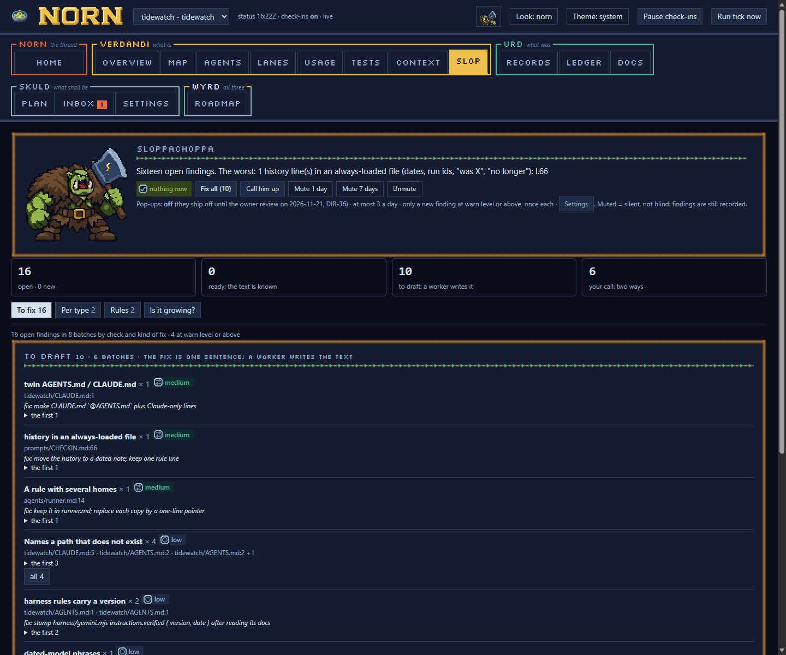

# Norn

Norn runs coding agents (Claude Code, Codex or any command-line agent) on your own machine, one step after another, without a
chat window open. It queues the work, merges finished steps through your tests, stays inside the usage limits you set and records
every decision it makes. You answer only the questions it cannot decide.


## Why use it

- **Work continues without you.** A step waits for the steps it depends on and starts when they land. A run that reaches its
  context limit hands off to a fresh session and carries on.
- **Usage stays inside your plan.** Before any run starts, Norn checks the worker cap, an hourly rate cap and a weekly stop. The
  Plan tab shows when the queued work would reach the limit.
- **Sessions stay small.** A run hands off to a fresh session at a set context size (110k tokens by default, set per agent role).
  The new session starts from the run's notes and Norn's records, not from the whole earlier conversation.
- **Main stays green.** Each lane has its own git worktree and one writer. Finished work merges to main one branch at a time,
  through your test command. When an agent says it is done, Norn checks for itself: clean tree, changes inside the brief's
  scope, tests passing.
- **Decisions are on record.** Every question, decision and instruction is an append-only record. You can see why something
  happened and overrule it.
- **Local and vendor-neutral.** Norn needs only Node 22 and git. It installs no npm packages, stores no API keys, and its dashboard
  listens on 127.0.0.1 only. Each run can use Claude Code, Codex or any other headless CLI.

For one task you watch from start to finish, Claude Code on its own is simpler. Norn's check-ins are agent turns too and count
toward your usage.

## What you get

The dashboard (`norn dash`):

- **Home**: a controller chat. It answers from the records and acts only through Norn's own commands; anything that needs your
  OK waits on an approval card. Check-ins, runs and questions appear in the same thread.
- **Plan** (`norn plan`): queued steps in start order with time estimates, the chains of steps that wait on each other, what
  merges next, and the usage forecast up to the weekly reset.


- **Inbox**: the questions waiting for you, each with its options and a recommended answer.
- **Slop**: findings from Norn's checks (leftover code in a branch, stale or contradicting instruction lines, paths that do not
  exist), grouped by the kind of fix. "Fix all" turns the selected findings into one fixer task that waits for your approval.
  SloppaChoppa, an orc, presents them; you can switch him off.



- **Docs**: a reader for the project's docs and every file that instructs an agent (CLAUDE.md, AGENTS.md, rules, memory), with
  findings next to the line.
- **Context**: the context limits for each agent role (no new step, hand-off, hard stop) and where to change them.
- **Roadmap** (`norn road`): themes and items whose status comes from the runs and records, never typed by hand.
- **The other tabs**: Overview (what needs you and what is running), Map and Lanes (every lane and its latest run), Agents
  (running sessions with their tokens and context), Usage (usage against the limits, and which model suits which work), Tests
  (which tests check real behaviour), Records and Ledger (every decision and check-in), and Settings.

Around the dashboard:

- **Adopting a repo** (`norn init`): drafts a roadmap, project rules, the test command and a first task from your repository;
  you approve each part.
- **Done checks** (per project): see [Done checks](#done-checks) below.
- **Notifications**: the ntfy phone app, a desktop notification or Pushover when something needs you.
- **Phone access** (`norn remote setup`): the dashboard on your phone over your own Tailscale network, for paired devices only.
- **MCP server** (`norn mcp`): agents in Claude Code or Codex can use Norn's commands; `norn harness install` adds it.
- **Screenshots** (`norn shot`): a signed-out headless browser for checking UI work.

## Quick start

You need Node 22 or newer, git, and the `claude` CLI signed in to your Claude account. `codex` and `gh` are optional. Norn runs on
Windows, Linux and macOS.

```
node engine/bin/norn.mjs init <your repo>   # set up Norn and add your repo; you approve each part
node engine/bin/norn.mjs run --executor fake --lane <first lane> --brief <its brief> --project <name> --wait   # a free rehearsal; init prints this line
node engine/bin/norn.mjs dash               # open the dashboard and start the first lane
```

`init` checks your tools and adds your repository as a project. It asks which limits profile to start with (`try-it` by default,
or `solo` / `heavy`), and whether an agent may read the repo for a better draft (one paid, read-only run) or git alone drafts it
(free). It writes nothing into your repo and applies nothing until you approve it. Setup also offers notifications and puts a
`norn` command in `~/.local/bin`. The full walkthrough is in [SETUP.md](SETUP.md).

Fresh installs were tested by following SETUP.md on clean Windows and Linux machines. macOS is covered only by the automated smoke
test, which runs on all three systems.

## How it works

- **Lanes and runs.** A lane is one line of work with its own worktree and branch. `norn run --executor <name> --lane L --brief F`
  starts an agent in it. Norn takes the lane's lock, checks the limits and records the run. A supervisor process then reads the
  result from the last line of the run's notes: `## DONE`, `## STOPPED: <why>` or `## HANDOFF`. A hand-off resumes the work in a
  fresh session. `--queue` and `--after` queue a run behind others, and `norn stop RUN-n` stops one. `norn executors --caps`
  lists the executors.
- **Check-ins.** A scheduled `norn tick` runs one short agent turn after each event and on a timer. It reviews finished runs,
  queues merges, starts the next steps and asks you what only you can decide.
- **Records.** Questions, decisions, directives, lanes and runs are append-only events, written only through `norn rec`,
  `norn run` and the dashboard. The markdown views are generated from them.
- **Executors.** A project's `project.json` defines them: `claude-compatible` (Claude Code against a compatible endpoint),
  `openai-compatible` (the Codex CLI with a custom provider) or `cli` (any headless CLI, its arguments as a template). Norn never
  stores an API key; the project names the environment variable that holds it. `projects/example/project.json` has one of each.
- **Settings.** Machine-wide limits live in `local/budget.json`, per-project policy in `project.json`; the Settings tab edits both.

### Done checks

Each part is set per project in Settings and is off by default.

- **Ready**: `norn run` refuses (or warns about) a brief without the lines `Scope:` (the paths the run may change), `Tests:` (test
  files or a command) and `Done:` (the end marker).
- **Done**: when a run says DONE, Norn checks that the tree is clean and the changes are inside Scope, then runs the Tests and the
  merge gate. A failure sends the run back once with the evidence; a second failure stops it.
- **Scope guard**: while a Claude run works, it cannot edit files outside its worktree and Scope, force-push, push to main (merge
  runs excepted), or run destructive git, gh or rm commands outside its worktree. The agent sees the reason and can carry on; each
  refusal is listed in the run's feed.
- **Plan review**: a finished plan gets one fresh, read-only review before its build starts.

## Commands

`norn help` lists every command; `norn <command> --help` shows one. The ones you meet first: `init`, `setup`, `doctor`, `smoke`,
`dash`, `status`, `runs`, `run`, `stop`, `tick`, `sched`, `rec`, `plan`, `road`, `lane`, `shot`.

## Layout

- `engine/`: the CLI (`bin/norn.mjs`), libraries (`lib/`), the dashboard (`dash/`, see [engine/dash/README.md](engine/dash/README.md)),
  prompts and schemas.
- `projects/example/`: the sample project the smoke test uses. Your projects live outside this clone (`~/.norn/projects/`).
- `local/` (machine.json, budget.json) and `state/` (records, runs, logs) are per machine and not tracked.

## Tests

`node --test "tests/*.test.mjs"` runs the suite in temp folders, with a fake executor in place of every agent. `norn smoke` runs a
fresh copy end to end. CI runs the smoke test on Windows, Ubuntu and macOS (`.github/workflows/smoke.yml`).

## Glossary

- **Lane**: one line of work with its own git worktree and branch. One agent at a time writes in it.
- **Run**: one agent session in a lane, until its `DONE`, `STOPPED` or `HANDOFF` line.
- **Check-in**: one short agent turn that reviews the state, rules on finished runs and starts the next ones (`norn tick`, by hand
  or from the scheduler).
- **Directive**: a standing instruction from you that every check-in follows until you revoke it.
- **Profile**: a starting set of limits and routing (`try-it`, `solo`, `heavy`); change any value later in Settings.
- **Urd, Verdandi, Skuld, Wyrd**: the names of the dashboard's tab groups. Urd is what was (records, ledger, docs), Verdandi what
  is (overview to slop), Skuld what shall be (plan, inbox, settings), and Wyrd all three at once (the roadmap).

## Beta feedback

This is a beta. Open this repository's **Issues** tab, choose **New issue**, then **Beta feedback**. The form asks what you tried,
what went wrong or was confusing, your OS, and whether to keep SloppaChoppa (to switch him off: Settings, Slop voice, On / off).

## License

MIT, see [LICENSE](LICENSE).
