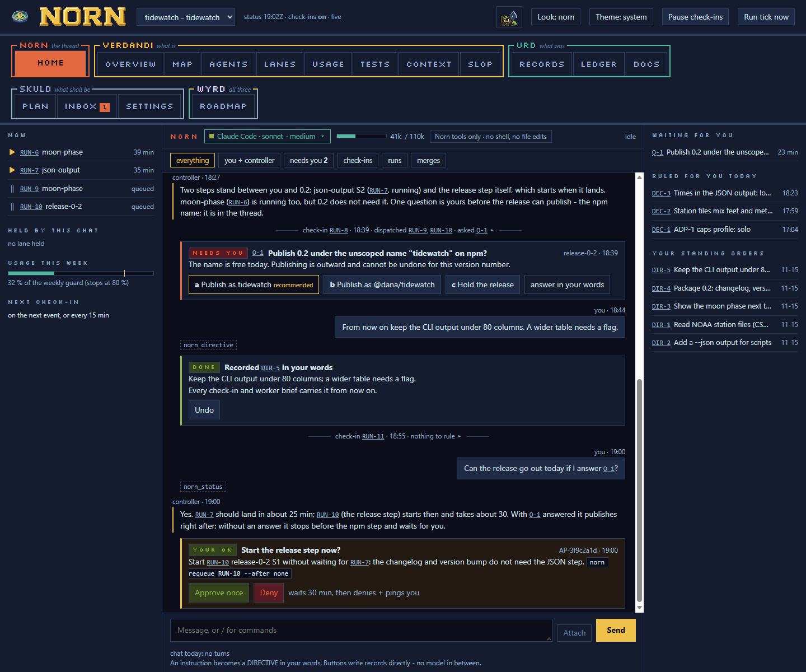
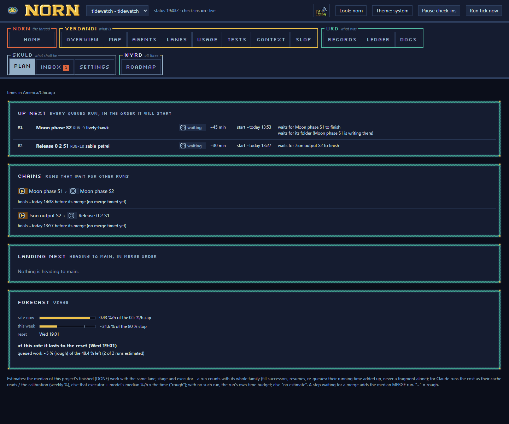

# Norn

**Stop being the scheduler for your coding agents.**

Claude Code and Codex can each do hours of real work - but one task at a time, and only while you are there to read the result
and start the next one. So you babysit a chat window, nothing moves overnight, and you find the usage limit by hitting it.

Norn takes over that job. Give it the work as lanes: it runs the agents headless, each in its own branch, checks in on its own,
reviews what finished, merges what passes your tests and starts the next step inside the budget you set. It asks you, with a
ping on your phone, only for the decisions that really are yours.

**Norn is built with Norn.** From 9 to 13 November 2026, building itself, it ran 119 agent tasks and 226 check-ins, landed work
on main 58 times and recorded 159 decisions - 141 of them made by its own check-ins. Its owner gave 16 instructions and answered
8 questions.



- **Work keeps moving while you sleep.** Hand-offs, resumes and a queue with dependencies: the next step starts when the last lands.
- **You decide only what is yours.** Everything else is ruled by the check-ins, on record, and you can overrule any of it.
- **No surprise limits.** Worker caps, an hourly usage cap and a weekly stop are checked before every start; the Plan tab
  forecasts when you would hit the limit.
- **Main stays green.** Each agent works in its own worktree; nothing reaches main except through a merge that runs your tests;
  a red CI run becomes a fix task.
- **Any agent CLI, all local.** Claude Code, Codex or any headless CLI, configured as data; Node 22 + git, no npm packages, the
  dashboard on 127.0.0.1, no keys stored.

## Why not just Claude Code?

Claude Code and Codex are the engines: one capable agent per session (Claude Code adds subagents, worktrees and hooks inside it).
Norn is the layer above them, for work that outlives one session.

| You want | Claude Code alone | With Norn |
|---|---|---|
| Work to keep going when you close the laptop | The session waits for your next message | The next step starts when the last one lands; runs hand off and resume on their own |
| Lower token cost on long work | One session grows, and every turn carries the whole conversation | Each run stops starting new steps past 90k tokens, hands off at 110k and never passes 150k (defaults, set per role in Settings), with the records as its memory, so no session gets big; `--cost cheap\|balanced\|quality` picks cheaper models for routine steps |
| To know what was decided, and why | Scattered across chat transcripts | Every question, decision and instruction is an append-only record you can read and overrule |
| To answer only what is yours | You answer everything the agent asks | Check-ins rule the routine; your questions wait in one inbox, with a phone or desktop ping |
| Several agents at once without chaos | You juggle terminals and branches | One worktree and one writer per lane; merges go to main one at a time, through your tests |
| To stay inside your plan | You find the limit by hitting it | Worker caps, an hourly rate cap and a weekly stop are checked before every start; the Plan tab forecasts the week |
| To see a long project at a glance | Terminal output | A local dashboard: talk to the controller on Home, the Plan, the Roadmap, the Inbox |
| More than one vendor | One vendor | Claude Code, Codex or any headless CLI, chosen per run |

When Claude Code alone is the right tool: one task you watch from start to finish. Norn pays off when the work is long, has many
steps, or should keep going while you are away. It has its own overhead - a short check-in turn on each event and on a timer - which
counts toward the usage caps like any other run.

## Quick start

```
node engine/bin/norn.mjs init <your repo>   # sets Norn up, adds your repo, drafts its setup; you approve each part
node engine/bin/norn.mjs run --executor fake --lane <first lane> --brief <its brief> --project <name> --wait   # the free rehearsal init printed
node engine/bin/norn.mjs dash               # the dashboard: start the first lane for real, answer what needs you
```

Run these from a clone of this repository, on Windows, Linux or macOS. `init` finds your tools, adds your repository as a project
and looks at it through git. It asks a few questions one at a time - the caps profile (`try-it` by default; `solo` and `heavy`
allow more), whether an agent may read the repo for a better draft (one paid read-only run) or git alone drafts it (free) - and
then drafts a roadmap, project rules, the test command and a first task. Nothing is written into your repo, and nothing is
applied until you approve it. Setup offers a phone or desktop notification and puts the `norn` command in
`~/.local/bin`. The full walkthrough, also in a scripted form for agents: [SETUP.md](SETUP.md).

## What you get
- **A dashboard** (`norn dash`): what needs you, what is running, usage against the caps, every record; answer a question, add a
  directive or overrule a decision from the page. Details: [engine/dash/README.md](engine/dash/README.md).
- **A controller chat on the Home tab**: talk to Norn in plain words; it answers from the records and acts only through Norn's
  own verbs, and an act that needs your OK waits on an approval card. Check-ins, runs and questions land in the same thread.
- **The Plan tab** (`norn plan`): every queued step in start order with its wait and time estimate, the chains, what lands on
  main next, and the usage forecast up to the weekly reset.



- **A roadmap** (`norn road`, the Roadmap tab): themes and items whose status is derived from the runs and records, never typed.
- **Adopting an existing repo** (`norn init` / `norn adopt`): a drafted setup in six parts, each line naming its source.
- **Check-ins that repair their own queue** (`norn requeue`): a queued step whose conditions changed is re-queued, its
  dependants follow.
- **A ping when it needs you** (`norn notify`; chosen at setup): the free ntfy phone app or a desktop notification.
- **Agents use your tools from a chat**: `norn mcp` is an MCP server, and `norn harness install` adds it to Claude Code or Codex.
- **Screenshots without your browser** (`norn shot`): a private, signed-out headless browser for UI checks.

## How it works
- **Lanes and runs.** A lane is one line of work with its own git worktree and branch. `norn run --executor <name> --lane L
  --brief F` starts one agent in it (`norn executors --caps` lists the executors: Claude Code, the Codex CLI when found, `fake`
  for a free rehearsal, and any you configure). It takes the lane's lock, checks the caps, records the run and leaves a detached
  supervisor that reads the outcome from the notes' last line (`## DONE`, `## STOPPED: <why>` or `## HANDOFF`, which resumes).
  `--queue` / `--after` queue a run behind others; `norn stop RUN-n` stops one.
- **Check-ins.** The scheduler (`norn sched install`) runs `norn tick`: the status, then one short headless agent turn that
  reviews finished runs, stages the merges, starts the next steps and asks you what only you can decide.
- **Records.** Questions, decisions, directives, lanes and runs are append-only events, written only through `norn rec`,
  `norn run` and the dashboard. The markdown views of them are generated: never edit them by hand.
- **Executors are data.** A project's `project.json` names them: `claude-compatible` (Claude Code against any compatible
  endpoint), `openai-compatible` (the Codex CLI with a custom provider) or `cli` (any headless CLI, its arguments as a template).
  A key is only ever an environment variable name. `projects/example/project.json` has one of each.
- **Settings.** Account-wide caps and budget in `local/budget.json`, per-project policy in `project.json`; both are edited in
  the dashboard Settings tab.

## Commands
`norn help` lists them all, grouped; `norn <command> --help` shows one's usage. The ones you meet first: `init`, `setup`,
`doctor`, `smoke`, `dash`, `status`, `runs`, `run`, `stop`, `tick`, `sched`, `rec`, `plan`, `road`, `lane`, `shot`.

## Layout
- `engine/` - the CLI (`bin/norn.mjs`), libraries (`lib/`), the dashboard (`dash/`), prompts and schemas.
- `projects/example/` - the sample project used by the smoke test. Your projects live outside this clone (`~/.norn/projects/`).
- `local/` (machine.json, budget.json) and `state/` (records, runs, logs) are per machine and not tracked.

## Tests
`node --test "tests/*.test.mjs"` (temp dirs only; a fake executor stands in for every agent). `norn smoke` runs a fresh copy end
to end; CI runs it on Windows, Ubuntu and macOS on pull requests
to main and on demand (`.github/workflows/smoke.yml`).

## Glossary
- **Lane**: one line of work with its own git worktree and branch. One agent at a time writes in it.
- **Directive**: a standing instruction from you that every check-in must follow until you revoke it.
- **Check-in**: one short agent turn that reviews the state, rules on finished runs and starts the next ones. It runs by hand
  (`norn tick`) or from the scheduler.
- **Profile**: a starting set of limits and routing (`try-it`, `solo`, `heavy`). It is only a starting point, so change any
  value afterwards in Settings.
- **Urd**, **Verdandi**, **Skuld**: the dashboard's three groups in the Norn look. Urd is what was (records, ledger, docs),
  Verdandi is what is (overview, map, agents, lanes, usage), and Skuld is what shall be (plan, inbox, settings).
- **Wyrd**: all three at once, which is the roadmap view.

## License
MIT, see [LICENSE](LICENSE).
